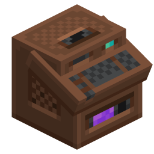

# Entropic Transmutation


A NeoForge mod for Minecraft 1.21.1 that adds a chaotic transmutation machine which can transform items at random. A stack of items inserted into the transmuter will be transformed into one or more stacks of items with a random value, guaranteed only be match the value of the input on average. Parts can be added to the machine to manipulate its behavior in various ways:

- **Type Suppressor:** Reduces how many different item types can be output at once
- **Count Suppressor:** Reduces the stack size of outputs for fewer but more valuable items
- **Void Amplifier:** Adds a chance to simply void inputs, but gives more valuable outputs accordingly
- **Transmuter Monitor:** Adds GUI controls and extends the machine, providing more attachment points for other parts

Item values are currently obtained from EMC provided by [ProjectE](https://www.curseforge.com/minecraft/mc-mods/projecte), which is a dependency.

## Building

```bash
./gradlew build
```

```bash
./gradlew runClient
```

`TEMPLATE_LICENSE.txt` applies to all code supplied by the [NeoForged MDK](https://github.com/NeoForged/MDK).
